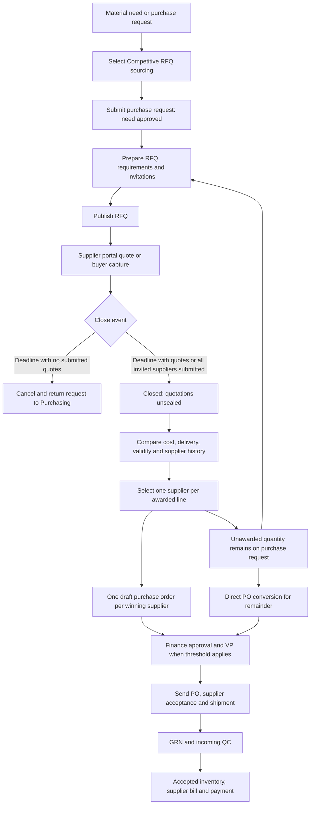

# Bidding and RFQ: End-to-End Process Study

Study date: 2026-10-09. Sources: the current workspace's Laravel services, policies, routes, resources, migrations and tests. The workspace contains existing changes, so this describes the files inspected, not just Git commit `14f8575ccaf2c9342fffa2059b27ecd15c028465`. Application code was not changed.

## 1. Business process and boundary

An RFQ is an invitation-only sourcing event for an approved purchase request. Purchasing sends the same requirements to selected suppliers, receives quotations, waits for closure, compares commercial terms and supplier history, then selects one supplier for each awarded line. Awarding creates draft purchase orders; purchasing approval, supplier fulfilment, incoming quality acceptance and payment remain downstream processes. The source separates RFQ lifecycle, supplier quotations, award decisions and commercial calculations into four services. [RequestForQuoteService.php:36](../api/app/Modules/Purchasing/Services/RequestForQuoteService.php#L36), [RfqAwardService.php:25](../api/app/Modules/Purchasing/Services/RfqAwardService.php#L25)

The current process is intentionally simpler than a formal tender platform: one quotation per supplier, edited in place; one winner per RFQ line; no quote versions, split awards, addenda, quote reconfirmation or quote-stage QC approval. The September 25 migration removed those structures and mapped the former evaluation states into the current lifecycle. [2026_09_25_130000_simplify_rfq_process.php:10](../api/database/migrations/2026_09_25_130000_simplify_rfq_process.php#L10), [2026_09_25_130000_simplify_rfq_process.php:36](../api/database/migrations/2026_09_25_130000_simplify_rfq_process.php#L36)



The RFQ portion of the diagram is implemented by create/publish, supplier save, close, comparison, award and hand-back methods. Downstream modules continue from the generated PO. [RequestForQuoteService.php:187](../api/app/Modules/Purchasing/Services/RequestForQuoteService.php#L187), [SupplierQuoteService.php:96](../api/app/Modules/Purchasing/Services/SupplierQuoteService.php#L96), [RfqAwardService.php:120](../api/app/Modules/Purchasing/Services/RfqAwardService.php#L120)

## 2. Purchase request readiness

Manual PR creation preserves an explicitly selected RFQ method and otherwise defaults to Direct PO. Automatically generated PRs preserve the supplied method or leave it unset. A PR cannot be submitted until a sourcing method is selected. [PurchaseRequestService.php:165](../api/app/Modules/Purchasing/Services/PurchaseRequestService.php#L165), [PurchaseRequestService.php:374](../api/app/Modules/Purchasing/Services/PurchaseRequestService.php#L374)

Submission validates units, resolves department ownership, prefills known suppliers/prices and assesses the budget estimate. Automatically generated requests require an accountable department. For RFQ sourcing, any required budget warning acknowledgement still applies, but submission approves the need immediately without the PR Finance/VP chain. The actual expenditure is checked later on the PO at the awarded price. Direct PO requests retain the PR money approval chain. [PurchaseRequestService.php:377](../api/app/Modules/Purchasing/Services/PurchaseRequestService.php#L377), [PurchaseRequestService.php:397](../api/app/Modules/Purchasing/Services/PurchaseRequestService.php#L397), [PurchaseRequestService.php:416](../api/app/Modules/Purchasing/Services/PurchaseRequestService.php#L416)

The RFQ PR lands on `approved` with conversion status `sourcing_pending`. Its approved event still enters the outbox, but the automatic PO consolidation listener exits unless sourcing is explicitly `direct_po`. Therefore submitting an RFQ PR does not accidentally create a direct order. [PurchaseRequestService.php:519](../api/app/Modules/Purchasing/Services/PurchaseRequestService.php#L519), [ConsolidatePurchaseOrders.php:74](../api/app/Modules/Purchasing/Listeners/ConsolidatePurchaseOrders.php#L74)

| Situation | Implemented outcome |
|---|---|
| Approved PR, method `rfq`, user may view PR and has `purchasing.rfq.manage` | May start RFQ if no active RFQ exists. |
| PR is draft, pending, rejected, cancelled or fully converted | Cannot start RFQ through the eligibility policy. |
| Approved Direct PO PR lacks supplier or price | Resolve through Direct PO conversion; RFQ start is refused. |
| Previous RFQ awarded only part of the need, or cancelled | Remaining approved quantity may start another RFQ or use Direct PO. |
| PR has an active draft, open or closed RFQ | No second active sourcing event; a creation retry returns the existing RFQ. |
| Any remaining line lacks an inventory item | RFQ creation fails before suppliers quote. |

These gates are split between PR access policy and locked creation. Creation also rejects an empty remainder. [PurchaseRequestAccessPolicy.php:152](../api/app/Modules/Purchasing/Policies/PurchaseRequestAccessPolicy.php#L152), [PurchaseRequestAccessPolicy.php:159](../api/app/Modules/Purchasing/Policies/PurchaseRequestAccessPolicy.php#L159), [RequestForQuoteService.php:190](../api/app/Modules/Purchasing/Services/RequestForQuoteService.php#L190), [RequestForQuoteService.php:200](../api/app/Modules/Purchasing/Services/RequestForQuoteService.php#L200)

Remaining quantity means requested quantity minus quantity already allocated to live POs, with purchasing unit conversions included. It is not a stock shortage calculation and does not wait for receipt or payment. PO creation checks cumulative coverage under the PR lock and refuses over-ordering. [PurchaseOrderService.php:465](../api/app/Modules/Purchasing/Services/PurchaseOrderService.php#L465), [PurchaseOrderService.php:518](../api/app/Modules/Purchasing/Services/PurchaseOrderService.php#L518)

## 3. RFQ preparation and invitations

The setup response returns each PR line's description, catalog code, unit, remaining quantity and whether an item is linked, together with active supplier choices. RFQ creation snapshots only remaining lines into RFQ items and keeps the PR line links. Buyers enter title, instructions, deadline, optional line specifications and optional need-by dates. [RequestForQuoteService.php:128](../api/app/Modules/Purchasing/Services/RequestForQuoteService.php#L128), [RequestForQuoteService.php:212](../api/app/Modules/Purchasing/Services/RequestForQuoteService.php#L212)

Validation requires a title up to 200 characters, a future deadline and at least one invitation. Instructions allow 10,000 characters, specifications 2,000 characters, exception reasons 2,000 characters, and explicitly supplied delivery dates must be after today. IDs in the form body are decoded before validation. [StoreRequestForQuoteRequest.php:14](../api/app/Modules/Purchasing/Requests/StoreRequestForQuoteRequest.php#L14), [StoreRequestForQuoteRequest.php:44](../api/app/Modules/Purchasing/Requests/StoreRequestForQuoteRequest.php#L44)

Supplier options include every active vendor, sorted with qualified vendors first. An invitation is qualified only when the vendor qualifies for every PR line considered by the supplier-options calculation. Qualification comes from the approved supplier list; supplier listings and historical POs are suggestions, not qualification. A nonqualified invitation needs a recorded exception reason. Inactive or deleted vendors and duplicate invitations are rejected. [RequestForQuoteService.php:155](../api/app/Modules/Purchasing/Services/RequestForQuoteService.php#L155), [RequestForQuoteService.php:570](../api/app/Modules/Purchasing/Services/RequestForQuoteService.php#L570), [VendorSourcingService.php:25](../api/app/Modules/Purchasing/Services/VendorSourcingService.php#L25)

The buyer sees reach as `portal` when an active supplier portal account exists, otherwise `email` when the vendor email is usable, otherwise `none`. This is a contact assessment, not a prerequisite for invitation: unreachable suppliers can still be invited and handled through manual capture. [RequestForQuoteService.php:106](../api/app/Modules/Purchasing/Services/RequestForQuoteService.php#L106), [RequestForQuoteService.php:511](../api/app/Modules/Purchasing/Services/RequestForQuoteService.php#L511)

Drafts may be edited; supplying invitations replaces the invitation set. Creation keys specification/date overrides by PR line ID, while the update service expects RFQ line ID. Once published, RFQ content is fixed except deadline extension and allowed uploads. A missing entered need-by date falls back to the PR date only if that PR date is still in the future. [RequestForQuoteService.php:252](../api/app/Modules/Purchasing/Services/RequestForQuoteService.php#L252), [RequestForQuoteService.php:269](../api/app/Modules/Purchasing/Services/RequestForQuoteService.php#L269), [RequestForQuoteService.php:599](../api/app/Modules/Purchasing/Services/RequestForQuoteService.php#L599)

Publishing requires a draft, at least one invitation and a future deadline. It sets `open` and `issued_at`, then records a publication event. Creation can publish immediately in the same transaction. Supplier listing/detail queries require `issued_at`, so drafts have not been sent to suppliers. [RequestForQuoteService.php:242](../api/app/Modules/Purchasing/Services/RequestForQuoteService.php#L242), [RequestForQuoteService.php:520](../api/app/Modules/Purchasing/Services/RequestForQuoteService.php#L520), [SupplierQuoteService.php:38](../api/app/Modules/Purchasing/Services/SupplierQuoteService.php#L38)

## 4. States, deadlines and cancellation

| RFQ state | Available next actions |
|---|---|
| `draft` | Edit, publish, attach documents or cancel. Suppliers cannot access the invitation. |
| `open`, before deadline | Suppliers save, submit, update or withdraw; buyer captures quotations, uploads documents, extends, cancels, or closes once every invitation is submitted. |
| `closed` | Authorized viewers compare; Purchasing awards or cancels. No more quotation edits. |
| `awarded` | View quotations, awards and generated POs. RFQ cannot be awarded again or cancelled. |
| `cancelled` | View outcome; PR remainder returns to Purchasing. Supplier prices remain sealed in the RFQ resource. |

The enum defines exactly these five states. `draft`, `open` and `closed` all count as active for PR exclusivity. The policy exposes action booleans, while service methods recheck transition rules under locks. [RfqStatus.php:7](../api/app/Modules/Purchasing/Enums/RfqStatus.php#L7), [RequestForQuoteAccessPolicy.php:64](../api/app/Modules/Purchasing/Policies/RequestForQuoteAccessPolicy.php#L64)

Extension requires an open RFQ whose existing deadline is still future, a nonblank reason and a new deadline later than the old one. It stores the latest reason and emits an extension event; it cannot reopen an expired or closed RFQ. [RequestForQuoteService.php:305](../api/app/Modules/Purchasing/Services/RequestForQuoteService.php#L305)

Early closure requires every invitation to be `submitted`; one missing response blocks it. Deadline closure needs only one submitted quotation to produce `closed`. With zero submitted quotations, the RFQ becomes `cancelled`, records “No quotations were received before the deadline.” and hands the request back. A saved draft does not count as a response. [RequestForQuoteAccessPolicy.php:55](../api/app/Modules/Purchasing/Policies/RequestForQuoteAccessPolicy.php#L55), [RequestForQuoteService.php:330](../api/app/Modules/Purchasing/Services/RequestForQuoteService.php#L330), [RequestForQuoteService.php:536](../api/app/Modules/Purchasing/Services/RequestForQuoteService.php#L536)

The scheduler runs `purchasing:close-due-rfqs` every minute with overlap prevention and one-server execution. Buyer and supplier index/detail reads also close due RFQs. Quote writes independently reject any deadline that is no longer future, so a delayed scheduler does not allow late quotation edits. Read-triggered closure has a supplier-scope caveat documented in section 11. [console.php:16](../api/routes/console.php#L16), [RequestForQuoteController.php:39](../api/app/Modules/Purchasing/Controllers/RequestForQuoteController.php#L39), [SupplierRfqController.php:37](../api/app/Modules/B2B/Controllers/SupplierRfqController.php#L37), [SupplierQuoteService.php:226](../api/app/Modules/Purchasing/Services/SupplierQuoteService.php#L226)

Manual cancellation is permitted only in draft, open or closed states. It records reason and resolution time, reconciles PR coverage and notifies suppliers only if the RFQ had been published. There is no post-award RFQ cancellation path in the current service. [RequestForQuoteService.php:381](../api/app/Modules/Purchasing/Services/RequestForQuoteService.php#L381)

## 5. Supplier quotation and manual capture

Suppliers see only invitations addressed to their vendor. First viewing an untouched invitation records `viewed_at` and moves `invited` to `viewed`. Detail loads the RFQ requirements, shared requirement documents, that vendor's documents, that vendor's quotation and that vendor's awards; competitors' quotations are not loaded. [SupplierQuoteService.php:69](../api/app/Modules/Purchasing/Services/SupplierQuoteService.php#L69), [SupplierRfqInvitationResource.php:14](../api/app/Modules/B2B/Resources/SupplierRfqInvitationResource.php#L14)

A quote body contains VAT treatment, optional freight, validity date, payment terms and notes, plus line responses. Each line is `quoted` or `no_quote`. Quoted lines require positive quantity and price, quantity cannot exceed the RFQ request, and the same RFQ line cannot appear twice or belong to another RFQ. The HTTP boundary allows quantity up to three decimal places, price up to four, freight up to two, and lead time from 0 to 3,650 days. [SupplierQuoteRules.php:29](../api/app/Modules/Purchasing/Requests/Concerns/SupplierQuoteRules.php#L29), [SupplierQuoteService.php:254](../api/app/Modules/Purchasing/Services/SupplierQuoteService.php#L254)

Saving edits the same quote header and replaces its quote items in a transaction. A new quotation starts as `draft`. Saving with `submit=true` requires at least one quoted line, an unexpired validity date when supplied, and an uploaded document of type `quotation_pdf`. The latest such document becomes the formal quotation path, and both quotation and invitation become `submitted`. Omitting other RFQ lines is allowed by the service; it does not require an explicit response for every requested line. [SupplierQuoteService.php:96](../api/app/Modules/Purchasing/Services/SupplierQuoteService.php#L96), [SupplierQuoteService.php:233](../api/app/Modules/Purchasing/Services/SupplierQuoteService.php#L233)

Submitted quotations can be updated by resubmitting while the RFQ remains open. A supplier cannot silently turn a submitted quotation into a draft through normal save; withdrawal explicitly returns it to `draft`, clears submission time and returns invitation status to `viewed`. After closure, all quote writes and withdrawals are refused. No revision history is retained by this model. [SupplierQuoteService.php:119](../api/app/Modules/Purchasing/Services/SupplierQuoteService.php#L119), [SupplierQuoteService.php:160](../api/app/Modules/Purchasing/Services/SupplierQuoteService.php#L160)

Manual capture uses the same save and validation path with `submit=true` and records the internal capturing user. The buyer first uploads the vendor's quotation document and then submits captured terms. A manual entry may never replace a quotation whose `portal_user_id` is set; the supplier must update its own portal quotation. [RequestForQuoteController.php:129](../api/app/Modules/Purchasing/Controllers/RequestForQuoteController.php#L129), [SupplierQuoteService.php:114](../api/app/Modules/Purchasing/Services/SupplierQuoteService.php#L114)

Supplier upload types are `quotation_pdf`, `certificate_of_analysis`, `resin_datasheet` and `safety_document`; internal upload types are shared `requirement_document` plus vendor-specific quotation, CoA and datasheet. Files are limited to 10,240 KB and PDF/JPG/JPEG/PNG MIME extensions. The document-type name `quotation_pdf` does not itself restrict that upload to an actual PDF: the shared file rule accepts images too. Documents are stored on the local disk; failed row creation deletes the newly stored file. [UploadRfqDocumentRequest.php:28](../api/app/Modules/Purchasing/Requests/UploadRfqDocumentRequest.php#L28), [Supplier/UploadRfqDocumentRequest.php:18](../api/app/Modules/B2B/Requests/Supplier/UploadRfqDocumentRequest.php#L18), [SupplierQuoteService.php:184](../api/app/Modules/Purchasing/Services/SupplierQuoteService.php#L184)

Only the formal quotation document and a quoted line are mandatory for submission. CoA, datasheet and safety evidence remain optional at quote stage; delivery acceptance is checked by downstream incoming QC. [SupplierQuoteService.php:233](../api/app/Modules/Purchasing/Services/SupplierQuoteService.php#L233), [SUPPLIER-RFQ-BIDDING-PLAN.md:72](SUPPLIER-RFQ-BIDDING-PLAN.md#L72)

## 6. Access, secrecy and authorization

| Actor | RFQ authority |
|---|---|
| Purchasing officer | Seeded RFQ view/manage permissions; operates sourcing and awards. PO financial approval belongs to other roles. |
| Finance officer and vice president | RFQ view permission; may see commercial comparison after close, but cannot run or award RFQs through that permission. |
| QC inspector | RFQ view permission; may see commercial prices, supplier history and documents after close, but cannot award. |
| PR requester without RFQ permissions | May open RFQs sourcing their own PR through the purchasing-view route; quote list and supplier documents are withheld. Award/PO response caveats are below. |
| System administrator | Wildcard permission permits management, but an explicit role check refuses RFQ award. |
| Supplier portal user | Separate authenticated portal guard; only own vendor's invitations, quotation, documents and outcome. |

Seeded grants and policy gates support this table. Permissions are not identical to roles: a custom non-admin role with `purchasing.rfq.manage` also satisfies award authority. [RolePermissionSeeder.php:603](../api/database/seeders/RolePermissionSeeder.php#L603), [RolePermissionSeeder.php:633](../api/database/seeders/RolePermissionSeeder.php#L633), [RolePermissionSeeder.php:817](../api/database/seeders/RolePermissionSeeder.php#L817), [RolePermissionSeeder.php:880](../api/database/seeders/RolePermissionSeeder.php#L880), [RequestForQuoteAccessPolicy.php:49](../api/app/Modules/Purchasing/Policies/RequestForQuoteAccessPolicy.php#L49)

RFQ view/manage holders have company-wide RFQ visibility. Others are scoped to their own creation or their own requested PR. This is internal row visibility, not a multi-company tenant implementation: the RFQ schema and policy contain no company identifier. Supplier tenancy is vendor-based and separately enforced. [RequestForQuoteAccessPolicy.php:20](../api/app/Modules/Purchasing/Policies/RequestForQuoteAccessPolicy.php#L20), [2026_09_16_000000_create_request_for_quote_tables.php:13](../api/database/migrations/2026_09_16_000000_create_request_for_quote_tables.php#L13), [B2BTenancyScopeMiddleware.php:51](../api/app/Modules/B2B/Middleware/B2BTenancyScopeMiddleware.php#L51)

The internal RFQ resource emits an empty quote array while draft/open/cancelled, and also for users without RFQ view/manage permission. Supplier documents are filtered under the same condition. Authorized commercial comparison is available only after close or award; document download separately enforces status and row access. Draft supplier quotes never enter the internal evaluable quote relation. [RequestForQuoteResource.php:18](../api/app/Modules/Purchasing/Resources/RequestForQuoteResource.php#L18), [RequestForQuoteService.php:93](../api/app/Modules/Purchasing/Services/RequestForQuoteService.php#L93), [RequestForQuoteService.php:404](../api/app/Modules/Purchasing/Services/RequestForQuoteService.php#L404), [RequestForQuoteService.php:490](../api/app/Modules/Purchasing/Services/RequestForQuoteService.php#L490)

Quote and quote-item audit snapshots replace commercial values with `[sealed]`, preventing normal administrative audit views from becoming a pre-close pricing channel. This is application serialization secrecy, not encryption against database administrators; prices remain in database quote rows. [SupplierQuote.php:95](../api/app/Modules/Purchasing/Models/SupplierQuote.php#L95), [SupplierQuoteItem.php:36](../api/app/Modules/Purchasing/Models/SupplierQuoteItem.php#L36)

Portal routes require supplier authentication, the exact supplier portal user model, an active user and active vendor, feature access, password checks and vendor tenancy middleware. Tenancy applies global vendor scopes to invitations, quotes, POs and documents and restores them after the request. Service checks add invitation ownership and document/RFQ matching. Route model binding uses HashIDs outside testing; body filters may also accept numeric IDs, so access checks remain the real authorization boundary. [B2B/routes.php:41](../api/app/Modules/B2B/routes.php#L41), [EnsurePortalGuard.php:36](../api/app/Common/Middleware/EnsurePortalGuard.php#L36), [B2BTenancyScopeMiddleware.php:58](../api/app/Modules/B2B/Middleware/B2BTenancyScopeMiddleware.php#L58), [SupplierQuoteService.php:212](../api/app/Modules/Purchasing/Services/SupplierQuoteService.php#L212), [HasHashId.php:23](../api/app/Common/Traits/HasHashId.php#L23), [HashIdFilter.php:15](../api/app/Common/Support/HashIdFilter.php#L15)

## 7. Comparison and financial calculation

Comparison combines submitted/resolved quote lines, calculated costs and the latest supplier performance snapshot: overall score, tier, on-time delivery rate, quality pass rate, NCR rate and reporting month. Each quoted line also exposes whether it meets the required date, based on proposed delivery date first, otherwise today's date plus lead time. Missing dates produce an unknown assessment. [RequestForQuoteService.php:411](../api/app/Modules/Purchasing/Services/RequestForQuoteService.php#L411), [RequestForQuoteService.php:611](../api/app/Modules/Purchasing/Services/RequestForQuoteService.php#L611)

Recommendation means lowest unexpired cost per offered unit for that RFQ line. When the buyer company is VAT registered, ranking uses cost excluding recoverable input VAT; otherwise it uses gross delivered cost. Quality, delivery, quantity coverage and payment terms are displayed but are not scored into the recommendation or enforced as award conditions. Equal costs retain the first encountered quote line. A quotation valid through today remains valid; a date before today expires it. [RequestForQuoteService.php:413](../api/app/Modules/Purchasing/Services/RequestForQuoteService.php#L413), [RequestForQuoteService.php:430](../api/app/Modules/Purchasing/Services/RequestForQuoteService.php#L430), [SupplierQuote.php:90](../api/app/Modules/Purchasing/Models/SupplierQuote.php#L90)

The shared calculator derives money with BCMath and centavo rounding. For quoted line `i`, goods value is `round2(quantity_i × unit_price_i)`; quote goods are the sum of those rounded line values. Freight is one quote-level amount. The VAT rate comes from company tax policy rather than supplier input. [RfqCommercialCalculator.php:30](../api/app/Modules/Purchasing/Services/RfqCommercialCalculator.php#L30), [RfqCommercialCalculator.php:55](../api/app/Modules/Purchasing/Services/RfqCommercialCalculator.php#L55)

| Declared VAT treatment | VAT | Quoted total |
|---|---|---|
| `exclusive` | `round2((goods + freight) × rate)` | `goods + freight + VAT` |
| `inclusive` | `round2((goods + freight) × rate / (1 + rate))` | `goods + freight` |
| `none` | `0.00` | `goods + freight` |

Gross delivered line cost allocates quote freight, plus exclusive VAT, by that line's share of quoted goods value. Net line cost allocates freight without exclusive VAT; inclusive prices/freight are divided by `1 + rate`. Unit costs divide the resulting allocation by offered quantity to four decimals. [RfqCommercialCalculator.php:71](../api/app/Modules/Purchasing/Services/RfqCommercialCalculator.php#L71), [RfqCommercialCalculator.php:95](../api/app/Modules/Purchasing/Services/RfqCommercialCalculator.php#L95)

For a PO containing only selected lines from a supplier's quote, freight follows the selected goods share. Inclusive quotes become net unit prices and net freight, with residual VAT chosen to preserve the selected gross total. Other charges are currently zero. Independent allocation rounding and the PO's narrower price precision mean exact equality across every fractional case is not established; section 11 records the concrete source risks. [RfqCommercialCalculator.php:120](../api/app/Modules/Purchasing/Services/RfqCommercialCalculator.php#L120), [RfqCommercialCalculator.php:169](../api/app/Modules/Purchasing/Services/RfqCommercialCalculator.php#L169)

Example from an existing feature test: Supplier A offers 10 at ₱50 plus ₱100 freight, with exclusive 12% VAT: goods ₱500, VAT ₱72, total ₱672. Supplier B offers 10 at ₱45 plus ₱200 freight, total ₱728. A is recommended despite B's lower unit price. The generated A PO carries subtotal ₱600, VAT ₱72 and total ₱672. [RfqBiddingTest.php:74](../api/tests/Feature/Purchasing/RfqBiddingTest.php#L74), [RfqBiddingTest.php:101](../api/tests/Feature/Purchasing/RfqBiddingTest.php#L101), [RfqBiddingTest.php:114](../api/tests/Feature/Purchasing/RfqBiddingTest.php#L114)

## 8. Award, PO creation and remainder

Award requires a closed RFQ, purchasing authority, a nonblank overall reason and at least one selected line. Every selected RFQ item must belong to this RFQ, appear once, match the selected quote item, and come from a submitted, unexpired quotation with a positive quoted quantity. The buyer may choose a supplier other than the recommendation; there is no additional approval or quality-review step inside RFQ award. [RfqAwardService.php:45](../api/app/Modules/Purchasing/Services/RfqAwardService.php#L45)

Awarded quantity is exactly the supplier's offered quantity. The API accepts line and quote-item selection rather than a separately entered award quantity. A partial offer therefore awards the entire partial offer and leaves the uncovered balance on the PR; one RFQ line cannot be split between two suppliers. The award stores supplier, quotation, quotation line, RFQ line, quantity, quoted price, allocated delivered value, reason, awarding user and time. [AwardRfqRequest.php:31](../api/app/Modules/Purchasing/Requests/AwardRfqRequest.php#L31), [RfqAwardService.php:93](../api/app/Modules/Purchasing/Services/RfqAwardService.php#L93)

Winning quotes become `awarded`, other submitted quotes become `not_awarded`, and every invitation receives a winning or losing outcome. A vendor winning any line has an awarded invitation even if some of its other lines were not selected. One draft PO is created per winning quotation/vendor in the award transaction. If any PO creation fails, the transaction rolls back the award operation. [RfqAwardService.php:110](../api/app/Modules/Purchasing/Services/RfqAwardService.php#L110), [RfqAwardService.php:120](../api/app/Modules/Purchasing/Services/RfqAwardService.php#L120)

Generated POs retain PR and RFQ header links; each line retains PR line, award and supplier quote links. The legacy column `supplier_quote_version_id` now points to the single retained quote rather than a version. The expected delivery date is the earliest selected RFQ requirement date, not necessarily the supplier's proposed date. Payment terms are carried into PO remarks. These POs are created through the system-generated path and marked `is_auto_generated`, but remain draft and require normal approval. [RfqAwardService.php:133](../api/app/Modules/Purchasing/Services/RfqAwardService.php#L133), [PurchaseOrderService.php:228](../api/app/Modules/Purchasing/Services/PurchaseOrderService.php#L228), [PurchaseOrderItem.php:59](../api/app/Modules/Purchasing/Models/PurchaseOrderItem.php#L59)

PO financial totals carry the RFQ's calculated freight and VAT rather than adding standard PO VAT again. The ordinary PO update service refuses commercially immutable RFQ-generated POs. The seeded PO chain is Finance followed by VP at `50000.00`; budget acknowledgement/enforcement, active vendor, segregation of duties and configured PPAP checks still apply. [PurchaseOrderService.php:211](../api/app/Modules/Purchasing/Services/PurchaseOrderService.php#L211), [PurchaseOrderService.php:632](../api/app/Modules/Purchasing/Services/PurchaseOrderService.php#L632), [WorkflowSeeder.php:74](../api/database/seeders/WorkflowSeeder.php#L74), [PurchaseOrderService.php:749](../api/app/Modules/Purchasing/Services/PurchaseOrderService.php#L749)

After award, the RFQ becomes `awarded` and reconciles actual PR coverage. Full PO coverage makes the PR `converted` / `converted`; any coverage with a remainder makes it `approved` / `partial`; no live coverage makes it `approved` / `not_started`. The remainder receives a note and can use another RFQ or Direct PO. The PR conversion status describes ordering coverage, not delivery completion. [RfqAwardService.php:125](../api/app/Modules/Purchasing/Services/RfqAwardService.php#L125), [RequestForQuoteService.php:558](../api/app/Modules/Purchasing/Services/RequestForQuoteService.php#L558), [PurchaseOrderService.php:545](../api/app/Modules/Purchasing/Services/PurchaseOrderService.php#L545), [PurchaseRequestAccessPolicy.php:228](../api/app/Modules/Purchasing/Policies/PurchaseRequestAccessPolicy.php#L228)

RFQ award is terminal. An awarded RFQ cannot be cancelled to undo its POs. A generated PO can be rejected or cancelled under PO-specific guards; cancellation is refused after full receipt/closure, with live linked bills, or with real received goods. Reconciliation can reopen PR coverage while retaining the historical RFQ award. [RequestForQuoteService.php:386](../api/app/Modules/Purchasing/Services/RequestForQuoteService.php#L386), [PurchaseOrderService.php:1022](../api/app/Modules/Purchasing/Services/PurchaseOrderService.php#L1022), [PurchaseOrderService.php:1164](../api/app/Modules/Purchasing/Services/PurchaseOrderService.php#L1164), [PurchaseOrderService.php:545](../api/app/Modules/Purchasing/Services/PurchaseOrderService.php#L545)

Freight enters downstream landed inventory cost through `PurchaseOrderItem::deliveredUnitCost()`, which distributes line/header freight and other charges over purchase quantity. Receiving uses that cost and converts it to base inventory units. This is a second commercial boundary worth testing when quotation prices use four decimals. [PurchaseOrderItem.php:104](../api/app/Modules/Purchasing/Models/PurchaseOrderItem.php#L104), [GrnService.php:264](../api/app/Modules/Inventory/Services/GrnService.php#L264)

## 9. Notifications and operational recovery

Lifecycle events are recorded in the durable outbox inside the business transaction, using RFQ-specific dedupe keys for publication, closure, cancellation and award; extension keys include the new deadline timestamp. Outbox publication occurs after commit, with a pending database row retained if dispatch fails. The event is registered with the RFQ notification listener. [RequestForQuoteService.php:639](../api/app/Modules/Purchasing/Services/RequestForQuoteService.php#L639), [RfqAwardService.php:127](../api/app/Modules/Purchasing/Services/RfqAwardService.php#L127), [OutboxService.php:38](../api/app/Common/Services/OutboxService.php#L38), [AppServiceProvider.php:377](../api/app/Providers/AppServiceProvider.php#L377)

| Event | Internal audience | Supplier communication |
|---|---|---|
| Published | No RFQ internal notice in this listener | Email to each invited vendor with usable email. |
| Extended | No RFQ internal notice in this listener | Email with changed deadline and last reason. |
| Closed with quotations | Active RFQ creator; fallback to active RFQ managers if audience empty | No closure email in this listener. |
| Awarded | Active RFQ creator and PR requester; fallback if audience empty | Every invitee receives outcome; winner is told PO follows internal approval. |
| Cancelled after publication | Active creator and requester; fallback if audience empty | Cancellation email to invitees. |
| Cancelled draft | No lifecycle event recorded by cancellation method | No supplier communication. |

The listener determines these audiences; it does not broadcast RFQ notices to every Finance/QC viewer. Missing email is recorded as “Supplier has no usable email address.”; successful queuing sets `email_notified_at`, which is not proof of final delivery. `portal_notified_at` is also stamped by the listener, while supplier RFQ visibility already comes from the invitation query. Delivery failures record error details and notify internal fallback users. [DeliverRfqLifecycleNotification.php:30](../api/app/Modules/Purchasing/Listeners/DeliverRfqLifecycleNotification.php#L30), [DeliverRfqLifecycleNotification.php:56](../api/app/Modules/Purchasing/Listeners/DeliverRfqLifecycleNotification.php#L56), [DeliverRfqLifecycleNotification.php:99](../api/app/Modules/Purchasing/Listeners/DeliverRfqLifecycleNotification.php#L99), [SupplierRfqLifecycleMail.php:57](../api/app/Modules/Purchasing/Mail/SupplierRfqLifecycleMail.php#L57)

## 10. Data model and invariants

| Record | Responsibility and durable links |
|---|---|
| `request_for_quotes` | Unique RFQ number, source PR, creator, current state, instructions, issue/deadline/closure/resolution times and cancellation/extension reasons. |
| `request_for_quote_items` | Snapshot of remaining PR need, original PR line/item, description, specification, quantity, unit and required date. Unique `(RFQ, PR line)`. |
| `request_for_quote_invitations` | Vendor, inviter, view/submission/outcome state, qualification exception and notification timestamps/errors. Unique `(RFQ, vendor)`. |
| `supplier_quotes` | One current quotation per `(RFQ, vendor)`, portal/capture attribution, VAT treatment, freight, totals, validity and formal document path. |
| `supplier_quote_items` | One response per `(quote, RFQ line)`, quantity, price, delivery terms and goods total. |
| `rfq_awards` | One durable award per RFQ line, selected quote/line/vendor and decision evidence. |
| `rfq_documents` | RFQ, optional vendor and quote, uploader, type, original name, MIME, size and storage path. Shared requirements have no vendor. |
| PO header/lines | Retain RFQ/PR/award/quote provenance and quoted commercial amounts. |

The original table migration defines foreign keys, numeric columns and source uniqueness; the simplification migration replaces version uniqueness with `(RFQ, vendor)` and adds RFQ-line award uniqueness. PO traceability is added separately. RFQ/quote quantities persist at four decimals, while HTTP quote quantities and PO quantities are limited to three; RFQ quote prices persist at four decimals, PO prices at two. [2026_09_16_000000_create_request_for_quote_tables.php:13](../api/database/migrations/2026_09_16_000000_create_request_for_quote_tables.php#L13), [2026_09_16_000000_create_request_for_quote_tables.php:99](../api/database/migrations/2026_09_16_000000_create_request_for_quote_tables.php#L99), [2026_09_25_130000_simplify_rfq_process.php:44](../api/database/migrations/2026_09_25_130000_simplify_rfq_process.php#L44), [2026_09_16_000001_add_rfq_traceability_to_purchase_orders.php:13](../api/database/migrations/2026_09_16_000001_add_rfq_traceability_to_purchase_orders.php#L13), [0061_create_purchase_order_items_table.php:21](../api/database/migrations/0061_create_purchase_order_items_table.php#L21), [0530_preserve_purchase_quantity_precision.php:13](../api/database/migrations/0530_preserve_purchase_quantity_precision.php#L13)

One active RFQ per PR is enforced by locking the PR and searching active states; the schema shown does not add an equivalent active-state unique index. Quote and award uniqueness have database constraints in addition to service checks. Financial award and PO creation share one transaction, and normal retries cannot award the RFQ twice. [RequestForQuoteService.php:190](../api/app/Modules/Purchasing/Services/RequestForQuoteService.php#L190), [2026_09_25_130000_simplify_rfq_process.php:49](../api/database/migrations/2026_09_25_130000_simplify_rfq_process.php#L49), [RfqAwardService.php:47](../api/app/Modules/Purchasing/Services/RfqAwardService.php#L47)

The simplification migration collapses older quote versions and folds old line/header charges into freight. It refuses incompatible active split awards and superseded awarded quote references. Its rollback restores schema shape but cannot reconstruct deleted versions, addenda or reconfirmations. Those are deployment/migration characteristics, not active RFQ product features. [2026_09_25_130000_simplify_rfq_process.php:83](../api/database/migrations/2026_09_25_130000_simplify_rfq_process.php#L83), [2026_09_25_130000_simplify_rfq_process.php:158](../api/database/migrations/2026_09_25_130000_simplify_rfq_process.php#L158), [2026_09_25_130000_simplify_rfq_process.php:227](../api/database/migrations/2026_09_25_130000_simplify_rfq_process.php#L227)

## 11. Findings and focused validation

These findings combine source inspection with narrow read-only PHP probes run by the coordinating study. No regression suite or cross-vendor business mutation was executed. The probes created in-memory model/resource objects and inspected generated SQL; they did not write database records.

1. **Supplier reads can run company-wide closure under supplier-specific global scopes.** Supplier RFQ index invokes `closeAllDue()`, which selects every due RFQ because the RFQ model is not vendor-scoped. `closeLocked()` then checks `SupplierQuote::query()` under the current supplier's global vendor scope. If supplier B has the only submitted quotation for a due RFQ and supplier A opens its RFQ list, the check can see no quotes and cancel B's event. PR hand-back also queries POs under that supplier scope and can miscalculate existing coverage. Validate with two vendors, separate RFQs and an expired RFQ with a submitted quotation. [SupplierRfqController.php:37](../api/app/Modules/B2B/Controllers/SupplierRfqController.php#L37), [RequestForQuoteService.php:353](../api/app/Modules/Purchasing/Services/RequestForQuoteService.php#L353), [RequestForQuoteService.php:536](../api/app/Modules/Purchasing/Services/RequestForQuoteService.php#L536), [B2BTenancyScopeMiddleware.php:58](../api/app/Modules/B2B/Middleware/B2BTenancyScopeMiddleware.php#L58)

2. **Requester price masking does not cover award data or the generated-PO endpoint.** RFQ detail always includes `RfqAwardResource`, whose output contains awarded unit price and delivered cost, even when quote serialization is sealed for a requester without RFQ permissions. The RFQ purchase-orders route also accepts `purchasing.view` and returns full PO resources after RFQ visibility, without separately applying PO row scope. Validate awarded RFQ detail and `/rfqs/{rfq}/purchase-orders` as the PR requester. [RequestForQuoteResource.php:48](../api/app/Modules/Purchasing/Resources/RequestForQuoteResource.php#L48), [RfqAwardResource.php:16](../api/app/Modules/Purchasing/Resources/RfqAwardResource.php#L16), [Purchasing/routes.php:55](../api/app/Modules/Purchasing/routes.php#L55), [RequestForQuoteController.php:142](../api/app/Modules/Purchasing/Controllers/RequestForQuoteController.php#L142)

3. **Four-decimal quotation prices narrow to two decimals on PO lines.** A permitted price such as `1.2345` at quantity `100` produces `123.45` from the full input during PO normalization, but the PO price column/model persists only two decimals. Receiving landed cost then reads the rounded price; quote, PO line total, receiving value and invoice comparisons can diverge. The inclusive VAT path also calculates four-decimal net prices before saving into the same two-decimal column. Validate quotation/PO/GRN/bill values with fractional prices and nontrivial VAT-inclusive division. [SupplierQuoteRules.php:43](../api/app/Modules/Purchasing/Requests/Concerns/SupplierQuoteRules.php#L43), [PurchaseOrderService.php:1464](../api/app/Modules/Purchasing/Services/PurchaseOrderService.php#L1464), [0061_create_purchase_order_items_table.php:21](../api/database/migrations/0061_create_purchase_order_items_table.php#L21), [PurchaseOrderItem.php:25](../api/app/Modules/Purchasing/Models/PurchaseOrderItem.php#L25), [RfqCommercialCalculator.php:138](../api/app/Modules/Purchasing/Services/RfqCommercialCalculator.php#L138)

4. **Independent freight/VAT rounding does not reconcile the last centavo.** Every line's allocation is rounded separately; there is no residual adjustment to make allocations sum to the quote total. Three equal goods lines sharing `0.01` freight can each receive `0.00` allocated freight while a full award PO carries `0.01`. Subset PO VAT is recalculated on subset goods/freight rather than summing the original independently rounded allocations. Validate multi-line pennies and partial awards before treating “comparison equals PO” as universal. [RfqCommercialCalculator.php:77](../api/app/Modules/Purchasing/Services/RfqCommercialCalculator.php#L77), [RfqCommercialCalculator.php:129](../api/app/Modules/Purchasing/Services/RfqCommercialCalculator.php#L129), [RfqCommercialCalculator.php:169](../api/app/Modules/Purchasing/Services/RfqCommercialCalculator.php#L169)

5. **Qualification checks include already ordered PR lines.** `supplierOptions()` assesses every PR item, while RFQ creation snapshots only lines with remaining quantity. A supplier qualified for all actual RFQ lines may still need an exception because it is not qualified for a PR line already covered by another PO. Validate a partly ordered two-item PR whose remainder has a different qualified vendor. [RequestForQuoteService.php:155](../api/app/Modules/Purchasing/Services/RequestForQuoteService.php#L155), [RequestForQuoteService.php:200](../api/app/Modules/Purchasing/Services/RequestForQuoteService.php#L200)

6. **Delivery and validity require buyer judgment beyond recommendation.** Ranking excludes expired quotes but does not exclude a supplier that misses the required delivery date or offers only a small portion of the need. Generated PO expected date uses the requirement date rather than the supplier promise. Quote validity is checked at award, while this simplified RFQ path no longer reconfirms terms during later PO approval or send. These are current behavior/limitations rather than proven failures. [RequestForQuoteService.php:442](../api/app/Modules/Purchasing/Services/RequestForQuoteService.php#L442), [RfqAwardService.php:81](../api/app/Modules/Purchasing/Services/RfqAwardService.php#L81), [RfqAwardService.php:138](../api/app/Modules/Purchasing/Services/RfqAwardService.php#L138), [2026_09_25_130000_simplify_rfq_process.php:77](../api/database/migrations/2026_09_25_130000_simplify_rfq_process.php#L77)

Read-only probe results strengthen findings 1–3: an awarded RFQ resource with RFQ permissions denied emitted `quotes=[]` but still emitted award unit price `1.2345` and delivered total `123.45`; an in-memory PO item with quantity `100`, input price `1.2345` and total `123.45` exposed price `1.23` and `deliveredUnitCost()` of `1.2300`; the submitted-quote closure query under a middleware-equivalent supplier scope included both `request_for_quote_id = 202` and `supplier_quotes.vendor_id = 101`. Thus serialization, model precision loss and query scoping were exercised. Actual unrelated RFQ cancellation and downstream accounting divergence remain unexecuted scenarios.

A read-only calculator probe also exercised finding 4: three quoted lines, each quantity `1` at price `1`, sharing `0.01` freight with VAT treatment `none`, received allocations `1.00`, `1.00`, `1.00`. Their sum was `3.00`, while `forPurchaseOrder()` returned `3.01` for the full selection. This confirms the allocation discrepancy without creating an RFQ or PO.

## 12. Documentation and verification evidence

The simplified plan is useful context but code is authoritative. Its statement that manual PRs are still created as Direct PO is incomplete: the current creation service preserves explicitly requested RFQ sourcing. The long E2E guide mixes current text with obsolete steps requiring Finance/VP approval of RFQ PRs, post-award RFQ cancellation and QC commercial price masking. Current code approves RFQ need on submit, refuses post-award RFQ cancellation and gives QC RFQ view permission with commercial comparison after closure. The legacy `supplier_quote_version_id` link is still real, but does not imply versioned quotations. [SUPPLIER-RFQ-BIDDING-PLAN.md:29](SUPPLIER-RFQ-BIDDING-PLAN.md#L29), [PurchaseRequestService.php:165](../api/app/Modules/Purchasing/Services/PurchaseRequestService.php#L165), [RFQ-BIDDING-E2E-TEST-GUIDE.md:108](RFQ-BIDDING-E2E-TEST-GUIDE.md#L108), [RFQ-BIDDING-E2E-TEST-GUIDE.md:686](RFQ-BIDDING-E2E-TEST-GUIDE.md#L686), [RFQ-BIDDING-E2E-TEST-GUIDE.md:793](RFQ-BIDDING-E2E-TEST-GUIDE.md#L793)

Existing backend feature tests cover the happy path to draft PO, sealed quotes, private drafts, updates/withdrawals, partial-offer hand-back, inclusive VAT, expired quotes, Direct PO refusal, unpublished drafts, manual capture, portal/manual ownership, audit masking, inventory-item readiness, requester quote masking, lazy closure, VAT-aware ranking and notification audiences. Later tests also cover PO approval below and above ₱50,000. These are source coverage observations; they do not establish that the backend suite was run in this study. [RfqBiddingTest.php:63](../api/tests/Feature/Purchasing/RfqBiddingTest.php#L63), [RfqBiddingTest.php:188](../api/tests/Feature/Purchasing/RfqBiddingTest.php#L188), [RfqBiddingTest.php:322](../api/tests/Feature/Purchasing/RfqBiddingTest.php#L322), [RfqBiddingTest.php:432](../api/tests/Feature/Purchasing/RfqBiddingTest.php#L432), [RfqBiddingTest.php:612](../api/tests/Feature/Purchasing/RfqBiddingTest.php#L612)

Existing freight tests cover landed cost allocation, receiving, staged GRN finalization, automatic/manual bill VAT and three-way matching. They use legacy PO charge fields that remain supported downstream, so they do not prove every simplified multi-line RFQ award allocation or four-decimal price case. [RfqFreightCapitalizationTest.php:100](../api/tests/Feature/Purchasing/RfqFreightCapitalizationTest.php#L100), [RfqFreightCapitalizationTest.php:263](../api/tests/Feature/Purchasing/RfqFreightCapitalizationTest.php#L263), [RfqFreightCapitalizationTest.php:411](../api/tests/Feature/Purchasing/RfqFreightCapitalizationTest.php#L411), [RfqFreightCapitalizationTest.php:527](../api/tests/Feature/Purchasing/RfqFreightCapitalizationTest.php#L527)

No deployment, application edit, migration or production business transaction was performed for this study.

## 13. Frontend workflow and browser evidence

The RFQ create/edit page supplies default instructions requesting the exact specification, quotation document and material CoA. Its default deadline is three weekdays ahead at 17:00 in the browser's local time; it converts that local input to an ISO instant for the API. The form shows remaining lines, supplier reach/qualification, exception reasons and unlinked-item blockers, with separate save-as-draft and publish paths. Weekdays are Monday–Friday rather than a company holiday calendar. [create.tsx:21](../spa/src/pages/purchasing/rfqs/create.tsx#L21), [create.tsx:30](../spa/src/pages/purchasing/rfqs/create.tsx#L30), [create.tsx:146](../spa/src/pages/purchasing/rfqs/create.tsx#L146), [create.tsx:168](../spa/src/pages/purchasing/rfqs/create.tsx#L168), [create.tsx:189](../spa/src/pages/purchasing/rfqs/create.tsx#L189)

RFQ detail renders actions from the server state/action matrix. Publish and close are direct buttons, while cancellation opens a reason dialog. Manual quote capture is a separate page, not the modal described in older instructions. It uploads the quotation document and optional CoA before posting captured terms; its supplier choices disable portal-reachable submitted invitations, with the backend ownership check remaining authoritative. [detail.tsx:150](../spa/src/pages/purchasing/rfqs/detail.tsx#L150), [detail.tsx:160](../spa/src/pages/purchasing/rfqs/detail.tsx#L160), [detail.tsx:550](../spa/src/pages/purchasing/rfqs/detail.tsx#L550), [manual-quote.tsx:88](../spa/src/pages/purchasing/rfqs/manual-quote.tsx#L88), [manual-quote.tsx:164](../spa/src/pages/purchasing/rfqs/manual-quote.tsx#L164)

Supplier quotation screens seed existing quotation values, support Save draft and submit/update paths, and validate three-decimal offered quantities. Save draft stores the commercial body but does not upload a newly selected file; uploads occur in the submit path. Therefore selecting a local file and saving a draft does not preserve that new file for another device or later page session. [quote.tsx:22](../spa/src/pages/portal/supplier/rfqs/quote.tsx#L22), [quote.tsx:62](../spa/src/pages/portal/supplier/rfqs/quote.tsx#L62), [quote.tsx:144](../spa/src/pages/portal/supplier/rfqs/quote.tsx#L144), [quote.tsx:153](../spa/src/pages/portal/supplier/rfqs/quote.tsx#L153)

Comparison displays the VAT-aware ranking basis, initially selects recommended winners and permits one radio selection per RFQ line. Award posts only RFQ/quote-item identifiers plus the reason; buyers do not enter a separate awarded quantity. The screen requires at least one line and a reason before submission. [compare.tsx:54](../spa/src/pages/purchasing/rfqs/compare.tsx#L54), [compare.tsx:58](../spa/src/pages/purchasing/rfqs/compare.tsx#L58), [compare.tsx:70](../spa/src/pages/purchasing/rfqs/compare.tsx#L70), [compare.tsx:246](../spa/src/pages/purchasing/rfqs/compare.tsx#L246), [compare.tsx:332](../spa/src/pages/purchasing/rfqs/compare.tsx#L332)

The coordinating study ran the mocked RFQ browser suite: **10 passed in 27.2 seconds**. That proves the exercised interface behavior against its mocked API contracts; it does not prove real database isolation, mail delivery, PO/GRN financial identity or the entire procurement chain. The separate live RFQ scenario reaches need-only PR sourcing, quotation, award, Finance/VP PO approval and supplier outcome, then ends; receiving, billing and payment are outside that scenario. [rfq-bidding.spec.ts](../spa/e2e/rfq-bidding.spec.ts), [live-rfq-bidding.spec.ts:539](../spa/e2e-real/live-rfq-bidding.spec.ts#L539)

Command executed from `spa/`:

```bash
npx playwright test e2e/rfq-bidding.spec.ts --project=desktop-firefox --workers=1 --retries=0 --reporter=list --output=/tmp/kwatog-rfq-study-playwright
```

Historical live test output is not a successful live run: the stored summary starts at `2026-10-08T03:23:10.971Z`, records `expected: 0`, `skipped: 198` and `unexpected: 0`. A skipped RFQ result proves no execution. Backend suites were inspected but not run because their refresh setup would mutate the shared test database. [summary.json:5448](../spa/e2e-real/results/summary.json#L5448)

One mocked contract differs from the actual tax policy: the supplier business-policy fixture supplies `vat_rate: '12.00'`, while `TaxPolicyService::vatRate()` accepts a fractional rate between 0 and 1 and returns `0.12` for 12%. The mocked quotation test does not assert the preview total, so the passing browser suite does not close this preview-calculation contract gap. [rfq-bidding.spec.ts:178](../spa/e2e/rfq-bidding.spec.ts#L178), [TaxPolicyService.php:13](../api/app/Common/Services/TaxPolicyService.php#L13)

## 14. Downstream process: the awarded PO through payment and returns

### 14.1 Submit and approve the actual expenditure

Purchasing submits the generated draft PO, moving it to `pending_approval` and creating approval records. The seeded chain is Finance first, then VP for amounts **at least ₱50,000.00**. The deployed workflow definition supplies the actual steps; submission stores a workflow snapshot and skips a threshold step only when the amount is below its threshold. Self approval and reusing a decision maker are refused. Vendor eligibility, budget acknowledgment/enforcement and any configured PPAP gate remain applicable. [PurchaseOrderService.php:703](../api/app/Modules/Purchasing/Services/PurchaseOrderService.php#L703), [WorkflowSeeder.php:73](../api/database/seeders/WorkflowSeeder.php#L73), [ApprovalService.php:78](../api/app/Common/Services/ApprovalService.php#L78), [ApprovalService.php:129](../api/app/Common/Services/ApprovalService.php#L129), [PurchaseOrderService.php:756](../api/app/Modules/Purchasing/Services/PurchaseOrderService.php#L756)

The PO remains pending until all required decisions finish. Final approval moves it to `approved` and records `PurchaseOrderApproved`. Rejection of the initial request cancels the PO, closes dispatch and reconciles its PR ordering coverage. [PurchaseOrderService.php:814](../api/app/Modules/Purchasing/Services/PurchaseOrderService.php#L814), [PurchaseOrderService.php:851](../api/app/Modules/Purchasing/Services/PurchaseOrderService.php#L851), [PurchaseOrderService.php:1055](../api/app/Modules/Purchasing/Services/PurchaseOrderService.php#L1055)

### 14.2 Transmit the order and obtain the supplier's decision

Approval invokes supplier dispatch through a registered listener. Successful publication to an available supplier portal recipient confirms transmission and marks the PO `sent`; a usable supplier email receives a queued copy. Without an available portal recipient, dispatch records `manual_required`: Purchasing must transmit the approved PDF externally and confirm completion. The manual confirmation method records evidence; it does not itself send the document. [AppServiceProvider.php:380](../api/app/Providers/AppServiceProvider.php#L380), [SupplierDispatchService.php:27](../api/app/Modules/Purchasing/Services/SupplierDispatchService.php#L27), [SupplierPortalDispatchGateway.php:30](../api/app/Modules/B2B/Services/SupplierPortalDispatchGateway.php#L30), [PurchaseOrderService.php:1084](../api/app/Modules/Purchasing/Services/PurchaseOrderService.php#L1084)

Supplier acceptance moves the PO to `acknowledged`. A delivery-date change requires a proposal; simple acceptance cannot change it. Other responses produce `supplier_proposed` or `supplier_declined`. Purchasing may resolve a proposal: unchanged/lower total can apply immediately, while any increased total returns the order to `pending_approval`. Increased terms apply only after approval completes; rejection restores original terms. Accepting a decline records the decision but leaves the PO declined for an explicit sourcing/cancellation decision. [SupplierResponseService.php:79](../api/app/Modules/Purchasing/Services/SupplierResponseService.php#L79), [SupplierResponseService.php:123](../api/app/Modules/Purchasing/Services/SupplierResponseService.php#L123), [SupplierResponseService.php:195](../api/app/Modules/Purchasing/Services/SupplierResponseService.php#L195), [PurchaseOrderService.php:818](../api/app/Modules/Purchasing/Services/PurchaseOrderService.php#L818)

The direct draft editor rejects RFQ-generated POs, but supplier proposal resolution has no equivalent RFQ exclusion. Therefore commercial immutability describes the direct editing route, not a guarantee that later supplier responses cannot change terms. [PurchaseOrderService.php:631](../api/app/Modules/Purchasing/Services/PurchaseOrderService.php#L631), [SupplierResponseService.php:243](../api/app/Modules/Purchasing/Services/SupplierResponseService.php#L243)

### 14.3 Record actual shipment, then warehouse receipt

**Supplier delivery plans are retired.** Historical GET remains available, while creation/cancellation return HTTP 410. The active fulfillment path records actual supplier shipments against acknowledged or partially received POs. Shipment entry requires unique positive PO-line quantities, cumulative quantity limits and dispatch-photo evidence; multiple partial shipments are supported. Received shipments cannot be edited. ETA is a forecast and does not change the agreed delivery date; late ETA can notify Purchasing. [B2B/routes.php:76](../api/app/Modules/B2B/routes.php#L76), [SupplierPoCapabilities.php:67](../api/app/Modules/B2B/Policies/SupplierPoCapabilities.php#L67), [SupplierShipmentService.php:123](../api/app/Modules/B2B/Services/SupplierShipmentService.php#L123), [SupplierShipmentService.php:247](../api/app/Modules/B2B/Services/SupplierShipmentService.php#L247)

Import tracking is an optional separate Supply Chain branch with `ordered`, `shipped`, `in_transit`, `customs`, `cleared`, `received` and cancellation states. Customs clearance needs evidence. Marking an import shipment received stages a GRN; it does not accept inventory. [ShipmentStatus.php:27](../api/app/Modules/SupplyChain/Enums/ShipmentStatus.php#L27), [ShipmentService.php:135](../api/app/Modules/SupplyChain/Services/ShipmentService.php#L135), [ShipmentService.php:194](../api/app/Modules/SupplyChain/Services/ShipmentService.php#L194)

`PurchaseOrderSent` stages an expected draft GRN. Actual supplier dispatch can link/reuse that expectation or stage a shipment-specific receipt. Warehouse finalization records physical quantities, location, unit conversion and lot/CoA metadata, then moves the GRN to `pending_qc`. CoA verification belongs to Quality. Physical receipt and quality acceptance are separate: received quantities may advance PO progress, but final `received` status requires accepted quantities to cover the order. [AppServiceProvider.php:383](../api/app/Providers/AppServiceProvider.php#L383), [GrnService.php:397](../api/app/Modules/Inventory/Services/GrnService.php#L397), [GrnService.php:650](../api/app/Modules/Inventory/Services/GrnService.php#L650), [GrnService.php:2543](../api/app/Modules/Inventory/Services/GrnService.php#L2543)

### 14.4 Incoming QC decides usable stock and rejection

GRN creation attempts incoming QC synchronously and records a durable creation event for replay. Each positive received inventory line receives an inspection using its active item/vendor quality plan or the configured fallback. Settlement waits for all sibling inspections and required independent checks. All passing lines accept; known defective quantities can produce partial acceptance and remainder rejection. Failed receipts normally await MRB according to policy. [GrnService.php:314](../api/app/Modules/Inventory/Services/GrnService.php#L314), [TriggerIncomingQC.php:77](../api/app/Modules/Quality/Listeners/TriggerIncomingQC.php#L77), [GrnService.php:1085](../api/app/Modules/Inventory/Services/GrnService.php#L1085)

Current pending failed supplier receipts permit MRB `return_to_supplier` only, with evidence and quantity checks for retaining sorted good goods. Older broad scrap/rework descriptions do not represent this current guard. Accepted quantities enter stock, update accepted PO totals and post inventory/GRNI accounting when Accounting is enabled. Partial acceptance publishes the same acceptance event for its accepted delta. [NcrService.php:708](../api/app/Modules/Quality/Services/NcrService.php#L708), [GrnService.php:784](../api/app/Modules/Inventory/Services/GrnService.php#L784), [GrnService.php:886](../api/app/Modules/Inventory/Services/GrnService.php#L886), [GrnGlPostingService.php:239](../api/app/Modules/Inventory/Services/GrnGlPostingService.php#L239)

### 14.5 Supplier invoice, three way match and AP posting

`GoodsReceiptNoteAccepted` stages a draft bill for accepted or partially accepted quantities. It carries vendor, PO, GRN, delivered inventory cost, vendor due terms and RFQ VAT allocation. Draft staging creates no AP journal. Later acceptance can update an uninvoiced draft or create a bill for newly unbilled quantities. [AppServiceProvider.php:374](../api/app/Providers/AppServiceProvider.php#L374), [BillService.php:341](../api/app/Modules/Accounting/Services/BillService.php#L341), [BillService.php:456](../api/app/Modules/Accounting/Services/BillService.php#L456), [BillService.php:489](../api/app/Modules/Accounting/Services/BillService.php#L489)

The supplier attaches invoice identity/file to eligible receipt bills. Grouped submission allows one supplier invoice to cover multiple bills, with declared gross equal to their totals. A valid nonvoid SupplierInvoice matching its linked bills is mandatory before a stock bill can be posted or paid. [SupplierInvoiceService.php:130](../api/app/Modules/B2B/Services/SupplierInvoiceService.php#L130), [SupplierInvoiceService.php:348](../api/app/Modules/B2B/Services/SupplierInvoiceService.php#L348), [BillService.php:1285](../api/app/Modules/Accounting/Services/BillService.php#L1285)

AP posting rechecks provenance, three way match, fiscal period, budget and withholding classification. Matching compares PO quantity/cost, accepted GRN quantity/cost and bill quantities/prices in base units, using configured tolerances and prior posted billing. Missing, duplicate, unmatched or excessive lines block posting; an authorized independent checker needs a reason to override a blocked match. Posting moves the bill to `unpaid` and records AP, GRNI clearing, input VAT and applicable purchase price variance. [BillService.php:514](../api/app/Modules/Accounting/Services/BillService.php#L514), [ThreeWayMatchService.php:46](../api/app/Modules/Purchasing/Services/ThreeWayMatchService.php#L46), [ThreeWayMatchService.php:172](../api/app/Modules/Purchasing/Services/ThreeWayMatchService.php#L172), [BillService.php:1462](../api/app/Modules/Accounting/Services/BillService.php#L1462)

### 14.6 Payment and explicit PO closure

Payment requires a posted unpaid/partial bill, valid supplier invoice, positive amount, appropriate date, active cash/bank leaf account, reference and idempotency key. Pending payment requests reserve outstanding balance. A nonfinal installment must be at least 50% of the bill total; a smaller final installment must clear the balance. [BillService.php:756](../api/app/Modules/Accounting/Services/BillService.php#L756), [BillService.php:786](../api/app/Modules/Accounting/Services/BillService.php#L786), [StoreBillPaymentRequest.php:25](../api/app/Modules/Accounting/Requests/StoreBillPaymentRequest.php#L25)

The October 9 migration defines VP-only payment approval for **bill total at least ₱50,000.00**, including smaller installments. Submission passes the bill total, not payment amount. Below threshold, all approval steps may be skipped and payment posting proceeds immediately. This describes repository configuration; deployed workflow values were not queried. Posting records AP/cash/withholding accounting and changes the bill to `partial` or `paid`; it does not initiate an external banking transfer. [2026_10_09_000300_bill_payment_vp_threshold.php:11](../api/database/migrations/2026_10_09_000300_bill_payment_vp_threshold.php#L11), [BillService.php:833](../api/app/Modules/Accounting/Services/BillService.php#L833), [BillService.php:989](../api/app/Modules/Accounting/Services/BillService.php#L989)

PO closure is an explicit action after full receipt. Short closure requires completed QC and no open inbound shipment. Bill payment does not close the PO. [PurchaseOrderService.php:1248](../api/app/Modules/Purchasing/Services/PurchaseOrderService.php#L1248), [PurchaseOrderService.php:1282](../api/app/Modules/Purchasing/Services/PurchaseOrderService.php#L1282)

### 14.7 Rejected receipts and later supplier returns

GRN rejection reverses the affected physical received quantities and opens a supplier return with `source_key = grn-rejection:{grn ID}`. Source links retain PO/GRN lines, item, lot and quantity; idempotency prevents duplicate returns and reversals. Purchasing completes this QC-generated work item with replacement due date, adequate defect evidence and completed QC. Its special submission path performs approval/disposition/completion and requests replacement against the original PO. It differs from the normal manual supplier-return approval, receive, inspect and disposition sequence. [GrnService.php:1384](../api/app/Modules/Inventory/Services/GrnService.php#L1384), [GrnService.php:2173](../api/app/Modules/Inventory/Services/GrnService.php#L2173), [ReturnRequestService.php:1725](../api/app/Modules/ReturnManagement/Services/ReturnRequestService.php#L1725), [ReturnRequestService.php:1763](../api/app/Modules/ReturnManagement/Services/ReturnRequestService.php#L1763), [ReturnRequestService.php:1780](../api/app/Modules/ReturnManagement/Services/ReturnRequestService.php#L1780)

Goods rejected before acceptance produce no supplier credit because no accepted payable exists. Goods returned after acceptance can generate and apply a supplier credit. A replacement PO is optional for applicable disposition paths; when it assumes the entire remaining obligation, the original PO is short closed. System replacement uses an explicit approval bypass and ordinary dispatch, so it must not be described as always repeating the original RFQ/Finance/VP chain. [ReturnRequestService.php:2902](../api/app/Modules/ReturnManagement/Services/ReturnRequestService.php#L2902), [ReturnRequestService.php:2940](../api/app/Modules/ReturnManagement/Services/ReturnRequestService.php#L2940), [ReturnRequestService.php:2971](../api/app/Modules/ReturnManagement/Services/ReturnRequestService.php#L2971), [PurchaseOrderService.php:887](../api/app/Modules/Purchasing/Services/PurchaseOrderService.php#L887)

## 15. Completion conditions and remaining verification

| Boundary | Evidence needed to call that boundary complete |
|---|---|
| RFQ decision | Terminal awarded/cancelled state; selected quantities, reason and generated PO links; unresolved PR quantity remains actionable. |
| Supplier commitment | PO approvals complete; transmission evidence; supplier acknowledgement or resolved proposal. |
| Goods | Actual receipt and independently checked QC; accepted quantities in stock; rejected quantities have return/replacement work. |
| Liability | Supplier invoice attached; accepted receipts matched; AP journal posted. |
| Settlement | Payment posted with applicable approvals; bill balance settled; credits/returns reconciled. |
| Order closure | PO explicitly closed or short closed under its receiving/shipment guards. |

These conditions follow the state transitions described above. An RFQ marked awarded is the sourcing decision's completion, not proof of delivered goods or settled liability.

Existing focused backend tests exercise downstream dispatch/response, supplier shipment, staged GRNs, QC sibling settlement, MRB, invoice gating, receipt billing, payment reservations and supplier returns. They were inspected, not rerun. Representative primary evidence: [SupplierDispatchTest.php:32](../api/tests/Feature/Purchasing/SupplierDispatchTest.php#L32), [SupplierShipmentTest.php:127](../api/tests/Feature/B2B/SupplierShipmentTest.php#L127), [IncomingQcLineSettleTest.php:137](../api/tests/Feature/Quality/IncomingQcLineSettleTest.php#L137), [IncomingMrbDispositionTest.php:330](../api/tests/Feature/Quality/IncomingMrbDispositionTest.php#L330), [SupplierInvoiceGateTest.php:43](../api/tests/Feature/Accounting/SupplierInvoiceGateTest.php#L43), [MultiGrnSupplierInvoiceTest.php:34](../api/tests/Feature/E2E/MultiGrnSupplierInvoiceTest.php#L34), [SupplierReturnSystemOpenTest.php:176](../api/tests/Feature/ReturnManagement/SupplierReturnSystemOpenTest.php#L176)

The current live RFQ browser specification reaches PO Finance/VP approval and supplier outcome; it does not continue into shipment, GRN/QC, invoice, payment or returns. Separate live procurement tests cover those areas using their own fixtures and workflows. The current `playwright.live.config.ts` matches only `live-procurement.spec.ts`, so the RFQ specification must be selected through the real configuration or another configuration that actually includes it. A fresh uninterrupted RFQ-to-payment browser run remains unverified. [live-rfq-bidding.spec.ts:405](../spa/e2e-real/live-rfq-bidding.spec.ts#L405), [live-rfq-bidding.spec.ts:535](../spa/e2e-real/live-rfq-bidding.spec.ts#L535), [live-procurement.spec.ts:1207](../spa/e2e-real/live-procurement.spec.ts#L1207), [live-procurement.spec.ts:1515](../spa/e2e-real/live-procurement.spec.ts#L1515), [live-procurement.spec.ts:2247](../spa/e2e-real/live-procurement.spec.ts#L2247), [playwright.live.config.ts:9](../spa/playwright.live.config.ts#L9)

Prioritize a focused two-supplier deadline-closure reproduction, requester award/PO visibility checks, and four-decimal quote/VAT-inclusive costs through receiving and billing. Then cover multi-line centavo allocation, all-expired quotations, re-sourcing a partly ordered PR, and one complete browser transaction with queue/scheduler recovery. These are verification targets from the findings, not changes made by this study.
