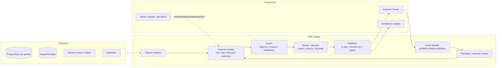

# Phase 2 — DSS Plan (STOP: reviewed before any build)

## 1. Vision & scope

**Project-wide DSS here means:** one engine (`DSS` module) that turns the existing 60+ scans,
scores, forecasts and escalations into **unified, explainable, measurable recommendations**
with a lifecycle (open → accepted/dismissed/snoozed/expired/executed + outcome), surfaced in one
**Decision Center** per user, under existing RBAC. No parallel approval/inventory system; every
action routes through current workflows.

**Classification:** data-driven (detectors over live queries + snapshots; the bulk), model-driven
(forecasting service extension, what-if simulator, allocation/sequencing heuristics), knowledge-driven
(SLA/escalation rules, approval chains, IATF touchpoints, playbooks). No ML black boxes in Waves 0–2;
Wave 3 anomaly detection uses explainable statistics (z-score/MAD, IQR) only.

**Out of scope:** B2B portal + Landing decisions (no internal recurring decision identified);
automated adverse HR decisions (D32 aggregate/advisory only, explicit approval gate); cost accounting,
bank rec, tax calendar (per CLAUDE.md cut scope — unchanged); custom dashboard builder; new chart lib.

## 2. Target architecture

Detector contract (interface): `id, domain, ownerRoles[], inputs(), params(defaults),
schedule|events, explain(template), severityRules, version, budget(ms/MB)`.
Runtime guarantees: independently toggleable, isolated (one failure never stops others),
idempotent (dedupe key), queue-friendly, time/memory-budgeted, audited.

Core tables (names adapt to conventions at build): `dss_recommendations` (polymorphic subject,
severity, priority, impact_estimate + estimate label, confidence, rationale JSON, action JSON,
status, dedupe key, expires_at, detector+version), `dss_recommendation_events`
(view/accept/dismiss+snooze+reason/execute/outcome), `dss_parameters` (+history/audit),
`dss_forecast_runs` (method, window, MAPE/MAE/bias), `dss_snapshots` (see §5), `dss_scenarios`,
`dss_run_logs` (duration, rows, emitted, errors).

Scoring (transparent, configurable): `priority = urgency(0-1, time-to-impact) × impact_php(0-1,
normalised) × confidence(0-1)`, adjusted by `effort_divisor`; money-denominated where possible,
else days/units, always labeled estimate. Lifecycle: same dedupe key = one open row that updates;
auto-expire/resolve on clear; snooze+reason+return date; SLA escalation; suppression + per-user
rate limits. Modes: `shadow` → `advisory` → `assisted-action` (prefilled existing forms only).
Cold start: rules/baselines + `data_sufficiency` flag + lowered confidence, never extrapolation.

## 3. Roadmap in waves

### Wave 0 — Foundation (M; 4–6 PRs)

Scope: `DSS` module shell + detector interface/registry + core tables + params service + Decision
Center shell (list/detail/explain/actions) + admin console (list/run-now/toggles/shadow/kill switch)
+ `stock_level_snapshots` daily job + master-hygiene detector (D27) + bottleneck reunification (D26
reuses `ChainBottleneckService`, adds recommendation rows) + `DemandBasis` unification (F-02) +
settings-write audit test (F-12) + route-guard matrix test (F-13) + seeders (demo thresholds only).

| PR | Deliverable | Acceptance | Rollback |
|---|---|---|---|
| W0-1 | tables + models + registry + params | migrate:fresh green; registry lists 2 stub detectors | drop tables; module unused |
| W0-2 | detector runner + run logs + shadow mode | stub runs logged, nothing displayed | disable schedule |
| W0-3 | recommendations lifecycle + events API (scoped) | lifecycle tests; scoping tests per role | feature-flag off |
| W0-4 | Decision Center shell + explain panel | role QA 3 roles; links resolve | revert SPA route |
| W0-5 | snapshots job + hygiene detector (shadow) | backtest vs live levels ±0%; hygiene lists gaps | stop cron |
| W0-6 | admin console + kill switch | toggle verified; kill stops all emission | — |

### Wave 1 — Quick wins (S–M each; priority ≥8 + low risk)

D13 (NCR/CAPA/8D → recommendations, E: escalations exist), D25 (approval-bottleneck view, E:
escalation service exists), D26 (stuck-document cards, E), D27 (hygiene score + fix links, new),
D22 (expiry digest, E), D09 (collection priority = amount×lateness×risk, P→recommend),
D03 (at-risk orders = MRP diagnostics + capacity conflicts, P), D21 (pre-payroll checklist, P),
D07 (WO intervention list, P), D12 (credit-limit pre-accept gate, confirm-or-build).
Each: 1 PR per detector family (≤10 PRs), start `shadow` 1–2 cycles, promote on precision review.

### Wave 2 — Broad coverage (M each)

D01 (unified reorder workbench: replenish + SS + projection + ABC-scheduled — needs F-11 cron),
D02 (supplier selection per item — needs F-01 price fix + G-02 history), D04 (ATP/CTP promise-date),
D06 (make-vs-wait with cost/delay trade-offs), D08 (dispatch consolidation), D11 (margin guard),
D14 (defect drill-down), D17/D18 (WO prioritization + PM defer view), D24 (slow/excess/obsolete),
D29 (budget trajectory), D28 (cash shortfall — needs G-06), D05 improvements (auto-slip proposals).
Depends: G-01/G-02/G-06/G-07 snapshots; F-01..F-11 fixes as separate PRs first.

### Wave 3 — Advanced (L; only after Waves 0–2 validated)

D31 simulator (copy-state compute, saved comparable scenarios), D15 SPC early-warning loop,
D16 traceability (needs G-03 lineage), D30 executive briefing + health score, D10 payment optimizer,
D23 returns rules (needs G-04), D32 attrition **only with explicit approval** (aggregate, restricted,
no adverse automation), anomaly detection (z/MAD/IQR), digital-twin-lite 14–30d, ask-the-DSS
(read-only, permission-scoped, cited).

## 4. Deadline subset (if time is short — minimal safe slice)

W0-1..W0-4 (engine + lifecycle + shell + kill switch) + D26 + D13 + D25 as the first three detectors
(all highest priority, all reuse existing logic, all read-only advisory). Everything else deferred.
Rationale: proves the engine, covers every role's biggest pain (stuck work), zero new automation risk.

## 5. Schema changes (each: migration + backfill + index)

1. `dss_recommendations`, `dss_recommendation_events`, `dss_parameters (+audit)`,
   `dss_forecast_runs`, `dss_scenarios`, `dss_run_logs` — new; no backfill; index
   `(status, severity, owner_scope)`, `dedupe_key` unique-where-open, `expires_at`.
2. `stock_level_snapshots(item,location,qty,reserved,wac,date)` — new; daily job; backfill: none
   possible (data lost) — start from deploy day, label pre-history "n/a". Index `(item,date)`.
3. `supplier_price_history(vendor,item,price,valid_from)` — new; receipt hook; backfill from
   `po_items`/`grn_items` prices best-effort, labeled.
4. `ar_ap_snapshots(period,bucket,amount)` + `capacity_snapshots` + `maintenance_kpi_snapshots`
   + `headcount_snapshots` + `return_snapshots` — new monthly writers; no backfill (recompute 1 prior
   month where source rows allow, else start fresh).
5. `oee_snapshots(machine,shift,date,a,p,q)` — new; backfill 30d from `production_logs`+downtime if
   feasible, else fresh.
6. `kpi_daily(code,date,actual)` for 3–4 critical KPIs (oee, attendance, ar_aging, wo_completion) —
   new; no backfill beyond recomputable window.
7. `maintenance_work_orders.machine_id` nullable denormalised (G-11) — backfill from polymorphic
   relation; index it.
8. `inventory.demand.movement_types` + `DemandBasis` refactor — no schema; code + settings seed.
9. Lot-lineage columns on issue/output (G-03, Wave 3) — design deferred to Wave 3 plan.
10. ABC `computed_at` + monthly cron (F-11) — column + schedule only.

Migration naming: check `ls api/database/migrations | grep '^<prefix>_'` first; depend on `2026_*`
tables → use `2026_` timestamp names (CLAUDE.md rule). Never rename the four duplicated prefixes.

## 6. Risk register

| Risk | Mitigation |
|---|---|
| False positives → alert fatigue | per-user rate limits, aggregation ("12 items…"), shadow-first, acceptance-rate dashboard, auto-retune proposals |
| Wrong recommendation → bad decision | confidence + sufficiency flags; R≥4 items need shadow + owner sign-off; human-in-loop always; assisted-action only via existing approvals |
| Data quality (nulls, single last_price, overwritten levels) | hygiene detector (D27) first; "data not available" labels; gaps register G-01..G-12 |
| Performance (low-RAM dev, large ledgers) | per-detector budgets, chunked queries, snapshot tables, Redis caching, Reverb only critical; full suite only at phase end, one suite at a time |
| Privacy/fairness (HR, D32) | aggregate/advisory only, restricted visibility, no protected-attribute inference, explicit approval gate before build |
| User trust (unexplained scores) | mandatory why-inputs (inputs/rule/threshold/calc/evidence links); "what would change this" view |
| Scope creep (33 decisions + extras) | waves fixed by score; extras (playbooks, journal, PDF briefing, decision SLAs) only after Wave 1 accepted |
| DSS failure cascading to ERP | detectors isolated + timed-out; failure → stale-labeled, core ops unaffected; kill switch |
| Scope confusion (parallel systems) | reuse rule enforced in review; approval/inventory/notify/audit reuse checklist per PR |

## 7. Validation strategy & success metrics

- **Seed/synthetic history**: deterministic 12–24mo generator (seasonality, trends, shocks, delays,
  stock-outs, breakdowns, quality events) with planted known problems → recall/precision per detector.
  Lives in seeders only; never leaks to prod numbers.
- **Backtest harness**: replay historical days from snapshots; per detector: recall/precision on planted
  issues, forecast MAPE/MAE/bias, warning lead time, false-positive rate → `docs/dss/evaluation.md`.
- **Automated tests**: unit per detector (normal/edge/empty/dirty fixtures), scoring, dedupe/lifecycle,
  idempotency, permission/scoping, parameter-change, forecast-vs-known-series, simulator-no-write,
  budget/isolation tests; property tests (reorder ≥0; allocation ≤ stock).
- **Live metrics**: acceptance rate, dismissal reasons, sampled precision, time-to-decision, outcome rate
  (stock-outs avoided, overdue reduced), forecast bias trend, alerts/user/day, estimated value (labeled).
- **Role QA**: per role — correct recommendations, correct data, working actions → `docs/dss/ROLE-QA.md`.
- Success bar for Wave 1 promotion: precision ≥80% on sampled shadow outputs + zero scoping failures +
  alerts/user/day within agreed cap (default: ≤5 non-info).

## 8. Open questions (business rules only you can answer — proposed defaults)

1. VP approval threshold stays ₱50k for DSS "high-value" flagging? Default: yes.
2. Service levels: safety-stock Z=1.65 (95%) for all classes, or A=99%/B=95%/C=90%? Default: class-tiered.
3. Stock-out risk bands (lead+7 high / +30 medium)? Default: keep current settings.
4. Dunning tiers 7/15/30 — keep for collection priority? Default: yes.
5. NCR SLA hours per severity — publish current values for confirmation? Default: keep, DSS surfaces them.
6. Overtime caps and manpower-load source of truth (attendance vs plan)? Default: DTR + swalayan schedule.
7. Statutory rates/rules — DSS **flags only, never asserts compliance**; HR/accounting verify? Default: yes, confirm.
8. D32 attrition indicators — build at all? Default: **no** until explicit written approval.
9. G-10 RESERVED workflows — enforce or stay advisory? Default: stay advisory; DSS assumes non-blocking.
10. Weekly briefing audience + quiet hours + digest channel (email opt-in exists)? Default: VP + dept heads,
    quiet 22:00–06:00, in-app + existing digest.
11. Cash-constrained payment priority policy (discounts vs criticality vs due)? Default: due → criticality → amount.
12. Return auto-disposition authority (value threshold for auto-approve)? Default: none — all manual until Wave 3.
13. Kill-switch holder + shadow-promotion approver? Default: system_admin operates, VP approves promotion.
